# P24 — Underline Text and Tier 1 Unicode Math Symbols in Question Field

**Status:** proposed (2026-10-29); reviewed 2026-10-29; not yet scheduled  
**Scope:** `admin_questions.php`, candidate view (`cbt.php` / `cbt_practice.php`), and OCR bookmarklet compatibility  
**Depends on:** D-01, D-03, D-18, D-20, D-24, D-31; requires explicit approval to change the PHP/server contract  
**Proposed decisions:** new entries to be added to `docs/DECISIONS.md` (next free ID: D-32)  
**Work package:** not yet listed in `docs/plan/README.md`; add a package before implementation  

---

## 1. Problem & Objectives

1. **Underlining Text:**
   In examination authoring (particularly English Language: lexis & structure, idioms, synonyms, antonyms, and sentence completion), questions frequently require specific words or phrases to be underlined. For example:
   > *"The minister's response was described as <u>evasive</u> by reporters."*
   Currently, the question input is a plain `<textarea id="question_text">`, lacking formatting tools or visual confirmation.

2. **Mathematical & Scientific Symbols (Tier 1):**
   Questions in Mathematics, Further Maths, Physics, and Chemistry regularly feature formulas, exponents, subscripts, Greek letters, and mathematical relations. For example:
   > *"Solve for x: 2x² - 5x + 3 = 0, where x ∈ ℝ."*  
   > *"Calculate the half-life when λ = 0.025 s⁻¹."*  
   Typing these on standard keyboards is difficult without a dedicated symbol palette.

3. **Key Architectural Constraints:**
   - Must **not** break the bulk OCR bookmarklet (`src/ui/ui.js` / `src/parser/parser.js`), which depends on `#question_text` being a standard `<textarea>`.
   - Must **not** require database schema alterations. The live server currently enforces 60,000 **bytes** with `strlen()`; the HTML `maxlength` counts UTF-16 code units. Verify that `questions.question_text` is declared as `TEXT` or larger (65,535 bytes) and that the connection uses `utf8mb4`. `<u>` tags and multi-byte math symbols consume the byte budget faster than ASCII.
   - Must **not** expose the site to Cross-Site Scripting (XSS). Only exact `<u>` and `</u>` tags may be restored after escaping; every other tag and attribute must remain escaped.
   - Must preserve undo/redo (`Ctrl+Z`) on the primary insertion path. `document.execCommand('insertText')` is the only widely available undo-preserving textarea insertion; the fallback must be tested and documented.
   - This workspace does not contain the live `admin_questions.php`, `cbt.php`, or `cbt_practice.php`. `AGENTS.md` forbids changing the PHP/database/server contract without explicit approval; see §5.

---

## 2. Technical Architecture & Data Flow

```mermaid
flowchart TD
    subgraph Admin_Browser["admin_questions.php (Authoring & Review)"]
        TB["Question Toolbar\n- [U] Underline (Ctrl+U)\n- Quick Math Symbols\n- Expandable Palette Drawer"]
        TA["<textarea id='question_text'>\n(Plain Text + UTF-8 + <u> tags)"]
        PV["Live Candidate Preview Box\n(Real-time HTML preview)"]
        BM["Bulk OCR Bookmarklet\n(src/ui/ui.js)"]

        TB -->|"Insert at cursor\n(execCommand / selection)"| TA
        BM -->|"Auto-fill parsed question"| TA
        TA -->|"input event"| PV
    end

    subgraph Server_Storage["Backend Storage"]
        POST["POST admin_questions.php\n(action=save_question / update_question)"]
        DB[("MySQL 'questions' table\nColumn 'question_text' TEXT")]

        TA -->|"Standard Form Submit"| POST
        POST -->|"PDO prepared statement"| DB
    end

    subgraph Candidate_Browser["cbt.php / cbt_practice.php (Candidate Interface)"]
        Fetch["Fetch question row"]
        Sanitize["render_candidate_question()\n1. htmlspecialchars()\n2. Case-insensitive restore of exact <u>/</u>\n3. Used by every question_text output"]
        CandidateUI["Rendered Question on Candidate Screen"]

        DB --> Fetch
        Fetch --> Sanitize
        Sanitize --> CandidateUI
    end
```



---

## 3. Implementation Details

### A. Markup for `admin_questions.php`

In the live file the textarea is already inside `<div class="admin-field">`. Replace that field's contents; do not wrap it in another `.admin-field` or duplicate the label. The toolbar and preview are inside the same form, so every button must keep `type="button"`.

Replace the standalone `<textarea id="question_text">` with the toolbar, textarea, and real-time preview:

```html
<div class="admin-field question-entry-group">
    <label for="question_text">Question</label>
    
    <!-- Formatting & Math Symbol Toolbar -->
    <div class="question-tools-toolbar" id="question_toolbar">
        <div class="tool-group">
            <button type="button" class="tool-btn" id="btn_tool_underline" title="Underline selected text (Ctrl+U)">
                <span style="text-decoration: underline; font-weight: 700;">U</span> Underline
            </button>
        </div>
        
        <div class="tool-group tool-symbols">
            <span class="tool-group-label">Quick Math:</span>
            <!-- Superscripts / Powers -->
            <button type="button" class="tool-sym" data-insert="²" title="Squared">x²</button>
            <button type="button" class="tool-sym" data-insert="³" title="Cubed">x³</button>
            <button type="button" class="tool-sym" data-insert="ⁿ" title="Power n">xⁿ</button>
            <!-- Subscripts -->
            <button type="button" class="tool-sym" data-insert="₁" title="Subscript 1">x₁</button>
            <button type="button" class="tool-sym" data-insert="₂" title="Subscript 2">x₂</button>
            <!-- Operators -->
            <button type="button" class="tool-sym" data-insert="±" title="Plus-minus">±</button>
            <button type="button" class="tool-sym" data-insert="√" title="Square root">√</button>
            <button type="button" class="tool-sym" data-insert="×" title="Multiplication">×</button>
            <button type="button" class="tool-sym" data-insert="÷" title="Division">÷</button>
            <button type="button" class="tool-sym" data-insert="≠" title="Not equal">≠</button>
            <button type="button" class="tool-sym" data-insert="≤" title="Less than or equal">≤</button>
            <button type="button" class="tool-sym" data-insert="≥" title="Greater than or equal">≥</button>
            <button type="button" class="tool-sym" data-insert="≈" title="Approximately">≈</button>
            <button type="button" class="tool-sym" data-insert="°" title="Degree">°</button>
            <!-- Fractions -->
            <button type="button" class="tool-sym" data-insert="½" title="One half">½</button>
            <button type="button" class="tool-sym" data-insert="¼" title="One quarter">¼</button>
            <button type="button" class="tool-sym" data-insert="¾" title="Three quarters">¾</button>
            <!-- Greek Letters -->
            <button type="button" class="tool-sym" data-insert="π" title="Pi">π</button>
            <button type="button" class="tool-sym" data-insert="θ" title="Theta">θ</button>
            <button type="button" class="tool-sym" data-insert="α" title="Alpha">α</button>
            <button type="button" class="tool-sym" data-insert="β" title="Beta">β</button>
            <button type="button" class="tool-sym" data-insert="Δ" title="Delta">Δ</button>
            <button type="button" class="tool-sym" data-insert="Ω" title="Omega">Ω</button>
            
            <button type="button" class="tool-btn tool-btn-toggle" id="btn_toggle_palette" title="Show all math and scientific symbols">
                More Symbols ▾
            </button>
        </div>
    </div>
    
    <!-- Expanded Symbol Palette Drawer -->
    <div class="math-palette-drawer" id="math_palette_drawer" style="display: none;">
        <div class="palette-category">
            <span class="palette-cat-title">Exponents:</span>
            <div class="palette-chars">
                <button type="button" class="palette-char">⁰</button><button type="button" class="palette-char">¹</button><button type="button" class="palette-char">²</button><button type="button" class="palette-char">³</button><button type="button" class="palette-char">⁴</button><button type="button" class="palette-char">⁵</button><button type="button" class="palette-char">⁶</button><button type="button" class="palette-char">⁷</button><button type="button" class="palette-char">⁸</button><button type="button" class="palette-char">⁹</button><button type="button" class="palette-char">⁺</button><button type="button" class="palette-char">⁻</button><button type="button" class="palette-char">ⁿ</button><button type="button" class="palette-char">ˣ</button><button type="button" class="palette-char">ʸ</button>
            </div>
        </div>
        <div class="palette-category">
            <span class="palette-cat-title">Subscripts:</span>
            <div class="palette-chars">
                <button type="button" class="palette-char">₀</button><button type="button" class="palette-char">₁</button><button type="button" class="palette-char">₂</button><button type="button" class="palette-char">₃</button><button type="button" class="palette-char">₄</button><button type="button" class="palette-char">₅</button><button type="button" class="palette-char">₆</button><button type="button" class="palette-char">₇</button><button type="button" class="palette-char">₈</button><button type="button" class="palette-char">₉</button><button type="button" class="palette-char">₊</button><button type="button" class="palette-char">₋</button><button type="button" class="palette-char">ₐ</button><button type="button" class="palette-char">ₑ</button><button type="button" class="palette-char">ᵢ</button><button type="button" class="palette-char">ₒ</button><button type="button" class="palette-char">ᵤ</button><button type="button" class="palette-char">ₓ</button>
            </div>
        </div>
        <div class="palette-category">
            <span class="palette-cat-title">Fractions:</span>
            <div class="palette-chars">
                <button type="button" class="palette-char">½</button><button type="button" class="palette-char">⅓</button><button type="button" class="palette-char">⅔</button><button type="button" class="palette-char">¼</button><button type="button" class="palette-char">¾</button><button type="button" class="palette-char">⅕</button><button type="button" class="palette-char">⅖</button><button type="button" class="palette-char">⅗</button><button type="button" class="palette-char">⅘</button><button type="button" class="palette-char">⅙</button><button type="button" class="palette-char">⅚</button><button type="button" class="palette-char">⅛</button><button type="button" class="palette-char">⅜</button><button type="button" class="palette-char">⅝</button><button type="button" class="palette-char">⅞</button>
            </div>
        </div>
        <div class="palette-category">
            <span class="palette-cat-title">Greek Letters:</span>
            <div class="palette-chars">
                <button type="button" class="palette-char">α</button><button type="button" class="palette-char">β</button><button type="button" class="palette-char">γ</button><button type="button" class="palette-char">δ</button><button type="button" class="palette-char">ε</button><button type="button" class="palette-char">θ</button><button type="button" class="palette-char">λ</button><button type="button" class="palette-char">μ</button><button type="button" class="palette-char">π</button><button type="button" class="palette-char">ρ</button><button type="button" class="palette-char">σ</button><button type="button" class="palette-char">τ</button><button type="button" class="palette-char">φ</button><button type="button" class="palette-char">ω</button><button type="button" class="palette-char">Δ</button><button type="button" class="palette-char">Ω</button><button type="button" class="palette-char">Σ</button>
            </div>
        </div>
        <div class="palette-category">
            <span class="palette-cat-title">Set Theory & Logic:</span>
            <div class="palette-chars">
                <button type="button" class="palette-char">∈</button><button type="button" class="palette-char">∉</button><button type="button" class="palette-char">⊂</button><button type="button" class="palette-char">⊆</button><button type="button" class="palette-char">∪</button><button type="button" class="palette-char">∩</button><button type="button" class="palette-char">∅</button><button type="button" class="palette-char">∧</button><button type="button" class="palette-char">∨</button><button type="button" class="palette-char">¬</button><button type="button" class="palette-char">⇒</button><button type="button" class="palette-char">⇔</button>
            </div>
        </div>
        <div class="palette-category">
            <span class="palette-cat-title">Geometry & Vectors:</span>
            <div class="palette-chars">
                <button type="button" class="palette-char">∠</button><button type="button" class="palette-char">∡</button><button type="button" class="palette-char">⊥</button><button type="button" class="palette-char">∥</button><button type="button" class="palette-char">△</button><button type="button" class="palette-char">→</button><button type="button" class="palette-char">←</button><button type="button" class="palette-char">↔</button><button type="button" class="palette-char">↑</button><button type="button" class="palette-char">↓</button>
            </div>
        </div>
    </div>

    <!-- Authoritative Form Textarea -->
    <textarea id="question_text" name="question_text" maxlength="60000" required><?php echo h($formValues['question_text']); ?></textarea>

    <!-- Real-time Candidate Preview -->
    <div class="question-preview-container" id="question_preview_wrap">
        <div class="preview-header">Candidate View Preview:</div>
        <div class="question-preview-body" id="question_preview_box"></div>
    </div>
</div>
```

---

### B. Stylesheet (CSS)

Add to the `<style>` block in `admin_questions.php`:

```css
.question-entry-group {
    position: relative;
}
.question-tools-toolbar {
    display: flex;
    flex-wrap: wrap;
    align-items: center;
    gap: 8px;
    background: #f8fafc;
    border: 1px solid #cbd5e1;
    border-bottom: none;
    border-radius: 8px 8px 0 0;
    padding: 6px 10px;
}
.tool-group {
    display: flex;
    align-items: center;
    flex-wrap: wrap;
    gap: 4px;
}
.tool-group-label {
    font-size: 12px;
    font-weight: 600;
    color: #64748b;
    margin-right: 4px;
}
.tool-btn, .tool-sym {
    background: #ffffff;
    border: 1px solid #cbd5e1;
    border-radius: 4px;
    padding: 3px 8px;
    font-size: 13px;
    color: #1e293b;
    cursor: pointer;
    line-height: 1.4;
    user-select: none;
    transition: background 0.15s, border-color 0.15s;
}
.tool-btn:hover, .tool-sym:hover {
    background: #e2e8f0;
    border-color: #94a3b8;
}
.tool-btn:active, .tool-sym:active {
    background: #cbd5e1;
}
.math-palette-drawer {
    background: #ffffff;
    border: 1px solid #cbd5e1;
    border-bottom: none;
    padding: 10px 14px;
}
.palette-category {
    margin-bottom: 6px;
    display: flex;
    align-items: center;
    gap: 8px;
}
.palette-category:last-child {
    margin-bottom: 0;
}
.palette-cat-title {
    font-size: 11px;
    font-weight: 700;
    text-transform: uppercase;
    color: #475569;
    min-width: 130px;
    flex-shrink: 0;
}
.palette-chars {
    display: flex;
    flex-wrap: wrap;
    gap: 4px;
}
.palette-chars button {
    display: inline-flex;
    align-items: center;
    justify-content: center;
    min-width: 32px;
    height: 32px;
    padding: 0;
    background: #f1f5f9;
    border: 1px solid #e2e8f0;
    border-radius: 4px;
    font: inherit;
    font-size: 14px;
    color: #1e293b;
    cursor: pointer;
    user-select: none;
    transition: background 0.15s;
}
.palette-chars button:hover {
    background: #cbd5e1;
}
.palette-chars button:focus-visible {
    outline: 2px solid #1769aa;
    outline-offset: 1px;
}
@media (max-width: 650px) {
    .question-tools-toolbar {
        gap: 6px;
        padding: 6px;
    }
    .tool-btn,
    .tool-sym {
        padding: 6px 9px;
    }
    .palette-category {
        align-items: flex-start;
        flex-direction: column;
        gap: 4px;
    }
    .palette-cat-title {
        min-width: 0;
    }
    .palette-chars button {
        min-width: 38px;
        height: 38px;
    }
}
.question-entry-grid textarea#question_text {
    border-radius: 0;
    margin-top: 0;
}
.question-preview-container {
    margin-top: 6px;
    background: #f8fafc;
    border: 1px solid #e2e8f0;
    border-radius: 6px;
    padding: 8px 12px;
}
.preview-header {
    font-size: 11px;
    font-weight: 700;
    text-transform: uppercase;
    color: #64748b;
    margin-bottom: 4px;
}
.question-preview-body {
    font-size: 14px;
    color: #1e293b;
    white-space: pre-wrap;
    line-height: 1.5;
    min-height: 24px;
}
.question-preview-body u {
    text-decoration: underline;
    text-underline-offset: 3px;
    font-weight: 500;
}
```

---

### C. Client Script for Textarea Insertion & Real-Time Preview

Add a `<script>` block at the end of `admin_questions.php` (after the existing `<script src="ocr_helper.js"></script>` tag). The current PHP file has no inline page script:

```javascript
(function initQuestionTools() {
    const textarea = document.getElementById('question_text');
    const previewBox = document.getElementById('question_preview_box');
    const toolbar = document.getElementById('question_toolbar');
    const drawer = document.getElementById('math_palette_drawer');
    const toggleBtn = document.getElementById('btn_toggle_palette');
    const underlineBtn = document.getElementById('btn_tool_underline');
    const form = textarea ? textarea.form : null;

    if (!textarea || !previewBox) return;

    /* Escape all HTML before restoring only the exact underline tags. */
    function escapeHtml(text) {
        return text
            .replace(/&/g, '&amp;')
            .replace(/</g, '&lt;')
            .replace(/>/g, '&gt;')
            .replace(/"/g, '&quot;')
            .replace(/'/g, '&#039;');
    }

    function updatePreview() {
        const safe = escapeHtml(textarea.value || '')
            .replace(/&lt;u&gt;/gi, '<u>')
            .replace(/&lt;\/u&gt;/gi, '</u>');
        previewBox.innerHTML = safe || '<span style="color:#94a3b8;font-style:italic">Question preview will appear here as you type...</span>';
    }

    function dispatchInput() {
        textarea.dispatchEvent(new Event('input', { bubbles: true }));
    }

    /* Remember the selection because tapping a toolbar button can blur the textarea. */
    let selStart = textarea.selectionStart || 0;
    let selEnd = textarea.selectionEnd || 0;

    function rememberSelection() {
        selStart = textarea.selectionStart || 0;
        selEnd = textarea.selectionEnd || 0;
    }

    ['select', 'keyup', 'mouseup', 'touchend', 'input'].forEach(function (eventName) {
        textarea.addEventListener(eventName, rememberSelection);
    });

    textarea.addEventListener('input', updatePreview);
    if (form) {
        form.addEventListener('reset', function () {
            setTimeout(updatePreview, 0);
        });
    }
    updatePreview();

    function insertAtCursor(content, isWrap, openTag, closeTag) {
        textarea.focus();
        const currentVal = textarea.value;
        const start = Math.max(0, Math.min(selStart, currentVal.length));
        const end = Math.max(start, Math.min(selEnd, currentVal.length));
        const selected = currentVal.substring(start, end);
        const insertion = isWrap ? openTag + selected + closeTag : content;
        const nextVal = currentVal.substring(0, start) + insertion + currentVal.substring(end);
        let inserted = false;

        try {
            inserted = document.execCommand('insertText', false, insertion);
        } catch (error) {
            inserted = false;
        }

        if (!inserted) {
            /* setRangeText is the fallback; undo support is browser-dependent. */
            try {
                textarea.setRangeText(insertion, start, end, 'end');
            } catch (error) {
                textarea.value = nextVal;
            }
            dispatchInput();
        }

        const caret = isWrap && !selected
            ? start + openTag.length
            : start + insertion.length;
        textarea.setSelectionRange(caret, caret);
        selStart = caret;
        selEnd = caret;
    }

    if (underlineBtn) {
        underlineBtn.addEventListener('click', function () {
            insertAtCursor('', true, '<u>', '</u>');
        });
    }

    textarea.addEventListener('keydown', function (event) {
        if ((event.ctrlKey || event.metaKey) && (event.key === 'u' || event.key === 'U')) {
            event.preventDefault();
            insertAtCursor('', true, '<u>', '</u>');
        }
    });

    if (toolbar) {
        toolbar.querySelectorAll('.tool-sym').forEach(function (button) {
            button.addEventListener('click', function () {
                const symbol = button.getAttribute('data-insert');
                if (symbol) insertAtCursor(symbol, false, '', '');
            });
        });
    }

    if (toggleBtn && drawer) {
        toggleBtn.addEventListener('click', function () {
            const isHidden = drawer.style.display === 'none';
            drawer.style.display = isHidden ? 'block' : 'none';
            toggleBtn.textContent = isHidden ? 'Less Symbols ▴' : 'More Symbols ▾';
        });

        drawer.querySelectorAll('.palette-chars button').forEach(function (button) {
            button.addEventListener('click', function () {
                const character = button.textContent.trim();
                if (character) insertAtCursor(character, false, '', '');
            });
        });
    }
})();
```

**Build rule:** the comments above are block comments so this snippet is safe if copied into `src/ui/ui.js`. Never add `//` comments to the modules; the bookmarklet build flattens the code to one line.

---

### D. Table List Display in `admin_questions.php`

At line 890 of `admin_questions.php`, prevent raw `<u>` tags from cluttering the 140-character summary. Do **not** use `strip_tags()`: it treats math comparisons such as `2<x<5`, `x<5`, or `a<b and c>d` as tags and can delete the rest of the text.

Add a small helper next to `short_text()`:

```php
function strip_underline_tags(string $text): string
{
    return preg_replace('#</?u>#i', '', $text) ?? $text;
}
```

```php
<!-- Before: -->
<td><?php echo h(short_text((string) $item['question_text'], 140)); ?></td>

<!-- After: -->
<td><?php echo h(short_text(strip_underline_tags((string) $item['question_text']), 140)); ?></td>
```

---

### E. Candidate CBT Practice Rendering (`cbt.php` / `cbt_practice.php`)

Render question content with a single shared helper. Define it once (a shared include, or guard with `function_exists()`), and use it at **every** place that outputs `question_text` — exam view, practice view, result review, print/export, and any API/JSON endpoint:

```php
function render_candidate_question(string $rawText): string
{
    $escaped = htmlspecialchars($rawText, ENT_QUOTES | ENT_SUBSTITUTE, 'UTF-8');
    return str_ireplace(['&lt;u&gt;', '&lt;/u&gt;'], ['<u>', '</u>'], $escaped);
}
```

Rules:

- `str_ireplace()` is case-insensitive, matching the preview's `/gi` behaviour.
- Only exact `<u>` and `</u>` are restored. `<u onclick="...">`, `<u >`, and all other tags stay escaped.
- Do not use `strip_tags($rawText, '<u>')`; it preserves attributes and is unsafe.
- If the current view does `nl2br(h($question_text))`, replace `h()` with `render_candidate_question()` and keep `nl2br()`; do not escape twice.
- Audit every `question_text` consumer before shipping; a missed raw `echo` shows literal tags or creates a stored-XSS path.

---

## 4. OCR Bookmarklet Compatibility

1. **Form Binding:** The bookmarklet in `src/ui/ui.js` sets:
   ```javascript
   $('question_text').value = q.question;
   ```
   Because `#question_text` remains the native `<textarea>`, parsing, queue loading, and form-saving keep working. There are no parser, storage-key, or server-contract changes.
2. **Required companion change for the preview:** `fillForm()` assigns `.value` directly, which does not fire an `input` event. Add this line immediately after the assignment:
   ```javascript
   $('question_text').dispatchEvent(new Event('input', { bubbles: true }));
   ```
   This is a `src/ui/ui.js` change. Rebuild with `node src/build/build.js`; do not add `//` comments to the module. The toolbar's `reset` listener already refreshes the preview after `form.reset()`.
3. **Review & Underline During Queue Step:**
   When an admin pauses at an English question during bookmarklet review, they can highlight a word in `#question_text`, press `Ctrl+U`, and click Save. The question saves with the `<u>` tags preserved.
4. **Pasted Math Symbols:**
   Unicode symbols present in OCR paste text (e.g. `x²`, `√`, `θ`) are preserved and submitted without alteration, subject to the byte limit in §5.

---

## 5. Implementation Preconditions and Open Issues

1. **Live files:** This workspace only has `archive/live-sources/admin_questions.php`; `cbt.php` and `cbt_practice.php` are absent. Do not edit the archive. Supply the live files or produce a patch for the live site.
2. **Contract approval:** `AGENTS.md` forbids PHP/database/server-contract changes. Get explicit approval before editing the live PHP, and record the new decisions in `docs/DECISIONS.md` (next free ID: D-32).
3. **Work tracker:** This document is not listed in `docs/plan/README.md`. Add a work package and status row before implementation.
4. **Output audit:** Find every `question_text` read and confirm it uses `render_candidate_question()` (or intentionally shows plain text).
5. **Schema/charset:** Confirm `questions.question_text` is declared as `TEXT` or larger and the PDO connection is `utf8mb4`. The server limit is 60,000 bytes, not characters.
6. **Browser matrix:** Test on Brave/Android and desktop Chromium. `execCommand('insertText')` is deprecated; verify undo and selection restoration on the target browser.
7. **No automated browser suite:** the checklist in §6 is manual.

## 6. Verification & Acceptance Checklist

| Check | Expected Result |
|---|---|
| Highlight text + `Ctrl+U` or click `[U]` | Wraps selection in `<u>...</u>` |
| Empty selection + `Ctrl+U` | Inserts `<u></u>` with cursor in the middle |
| Browser Undo (`Ctrl+Z`) after underline/symbol insertion | Reverts the insertion on the primary `execCommand` path; fallback behaviour is recorded after testing |
| Quick symbol buttons (`x²`, `√`, `±`, `π`) | Inserts character at the remembered cursor position |
| "More Symbols ▾" drawer | Toggles open/close and inserts clicked characters |
| Mobile toolbar tap | Textarea selection is retained and the symbol lands at the caret |
| Palette keyboard use | Each palette character is focusable and activates with Enter/Space |
| Live Preview box | Reflects typing, bookmarklet fill, skip, and reset |
| Form submission (Add & Edit) | Saves question text with tags and UTF-8 symbols to DB |
| Admin table listing | Shows `2<x<5` intact and no raw `<u>` tags |
| Candidate CBT practice view | Shows real underline and accurate math symbols |
| Candidate XSS vectors | `<script>`, `<u onclick="...">`, and `&lt;u&gt;` are escaped as text |
| Case-insensitive tags | `<U>text</U>` renders as underlined text in the candidate view |
| Bookmarklet execution | Queue load, navigation, preview refresh, and auto-save operate without error |
| Byte limit | A long Unicode question is rejected at 60,000 bytes with the existing server message |
