# P24 — Underline Text and Tier 1 Unicode Math Symbols in Question Field

**Status:** proposed (2026-10-29); implementation specification  
**Scope:** `admin_questions.php`, candidate view (`cbt.php` / `cbt_practice.php`), and OCR bookmarklet compatibility  
**Depends on:** D-54–D-65  
**Proposed decision:** D-67  

---

## 1. Problem & Objectives

1. **Underlining Text:**
   In examination authoring (particularly English Language: lexis & structure, idioms, synonyms, antonyms, and sentence completion), questions frequently require specific words or phrases to be underlined. For example:
   > *"The minister's response was described as <u>evasive</u> by reporters."*
   Currently, the question input is a plain `<textarea id="question_text">`, lacking formatting tools or visual confirmation.

2. **Mathematical & Scientific Symbols (Tier 1):**
   Questions in Mathematics, Further Maths, Physics, and Chemistry regularly feature formulas, exponents, subscripts, Greek letters, and mathematical relations. For example:
   > *"Solve for x: 2x² - 5x + 3 = 0, where x ∈ ℝ."*  
   > *"Calculate the half-life when λ = 0.025 s⁻¹."*  
   Typing these on standard keyboards is difficult without a dedicated symbol palette.

3. **Key Architectural Constraints:**
   - Must **not** break the bulk OCR bookmarklet (`src/ui/ui.js` / `src/parser/parser.js`), which depends on `#question_text` being a standard `<textarea>`.
   - Must **not** require database schema alterations (MySQL `TEXT` with UTF-8 / `utf8mb4` already stores Unicode and HTML strings up to 60,000 characters).
   - Must **not** expose the site to Cross-Site Scripting (XSS).
   - Must maintain full undo/redo history (`Ctrl+Z`) when inserting symbols or wrapping tags in the browser.

---

## 2. Technical Architecture & Data Flow

```mermaid
flowchart TD
    subgraph Admin_Browser["admin_questions.php (Authoring & Review)"]
        TB["Question Toolbar\n- [U] Underline (Ctrl+U)\n- Quick Math Symbols\n- Expandable Palette Drawer"]
        TA["<textarea id='question_text'>\n(Plain Text + UTF-8 + <u> tags)"]
        PV["Live Candidate Preview Box\n(Real-time HTML preview)"]
        BM["Bulk OCR Bookmarklet\n(src/ui/ui.js)"]

        TB -->|"Insert at cursor\n(execCommand / selection)"| TA
        BM -->|"Auto-fill parsed question"| TA
        TA -->|"input event"| PV
    end

    subgraph Server_Storage["Backend Storage"]
        POST["POST admin_questions.php\n(action=save_question / update_question)"]
        DB[("MySQL 'questions' table\nColumn 'question_text' TEXT")]

        TA -->|"Standard Form Submit"| POST
        POST -->|"PDO prepared statement"| DB
    end

    subgraph Candidate_Browser["cbt.php / cbt_practice.php (Candidate Interface)"]
        Fetch["Fetch question row"]
        Sanitize["render_candidate_question()\n1. htmlspecialchars()\n2. Unescape safe <u> and </u>"]
        CandidateUI["Rendered Question on Candidate Screen"]

        DB --> Fetch
        Fetch --> Sanitize
        Sanitize --> CandidateUI
    end
```



---

## 3. Implementation Details

### A. Markup for `admin_questions.php`

Replace the standalone `<textarea id="question_text">` with the toolbar, textarea, and real-time preview:

```html
<div class="admin-field question-entry-group">
    <label for="question_text">Question</label>
    
    <!-- Formatting & Math Symbol Toolbar -->
    <div class="question-tools-toolbar" id="question_toolbar">
        <div class="tool-group">
            <button type="button" class="tool-btn" id="btn_tool_underline" title="Underline selected text (Ctrl+U)">
                <span style="text-decoration: underline; font-weight: 700;">U</span> Underline
            </button>
        </div>
        
        <div class="tool-group tool-symbols">
            <span class="tool-group-label">Quick Math:</span>
            <!-- Superscripts / Powers -->
            <button type="button" class="tool-sym" data-insert="²" title="Squared">x²</button>
            <button type="button" class="tool-sym" data-insert="³" title="Cubed">x³</button>
            <button type="button" class="tool-sym" data-insert="ⁿ" title="Power n">xⁿ</button>
            <!-- Subscripts -->
            <button type="button" class="tool-sym" data-insert="₁" title="Subscript 1">x₁</button>
            <button type="button" class="tool-sym" data-insert="₂" title="Subscript 2">x₂</button>
            <!-- Operators -->
            <button type="button" class="tool-sym" data-insert="±" title="Plus-minus">±</button>
            <button type="button" class="tool-sym" data-insert="√" title="Square root">√</button>
            <button type="button" class="tool-sym" data-insert="×" title="Multiplication">×</button>
            <button type="button" class="tool-sym" data-insert="÷" title="Division">÷</button>
            <button type="button" class="tool-sym" data-insert="≠" title="Not equal">≠</button>
            <button type="button" class="tool-sym" data-insert="≤" title="Less than or equal">≤</button>
            <button type="button" class="tool-sym" data-insert="≥" title="Greater than or equal">≥</button>
            <button type="button" class="tool-sym" data-insert="≈" title="Approximately">≈</button>
            <button type="button" class="tool-sym" data-insert="°" title="Degree">°</button>
            <!-- Fractions -->
            <button type="button" class="tool-sym" data-insert="½" title="One half">½</button>
            <button type="button" class="tool-sym" data-insert="¼" title="One quarter">¼</button>
            <button type="button" class="tool-sym" data-insert="¾" title="Three quarters">¾</button>
            <!-- Greek Letters -->
            <button type="button" class="tool-sym" data-insert="π" title="Pi">π</button>
            <button type="button" class="tool-sym" data-insert="θ" title="Theta">θ</button>
            <button type="button" class="tool-sym" data-insert="α" title="Alpha">α</button>
            <button type="button" class="tool-sym" data-insert="β" title="Beta">β</button>
            <button type="button" class="tool-sym" data-insert="Δ" title="Delta">Δ</button>
            <button type="button" class="tool-sym" data-insert="Ω" title="Omega">Ω</button>
            
            <button type="button" class="tool-btn tool-btn-toggle" id="btn_toggle_palette" title="Show all math and scientific symbols">
                More Symbols ▾
            </button>
        </div>
    </div>
    
    <!-- Expanded Symbol Palette Drawer -->
    <div class="math-palette-drawer" id="math_palette_drawer" style="display: none;">
        <div class="palette-category">
            <span class="palette-cat-title">Exponents:</span>
            <div class="palette-chars">
                <span>⁰</span><span>¹</span><span>²</span><span>³</span><span>⁴</span><span>⁵</span><span>⁶</span><span>⁷</span><span>⁸</span><span>⁹</span><span>⁺</span><span>⁻</span><span>ⁿ</span><span>ˣ</span><span>ʸ</span>
            </div>
        </div>
        <div class="palette-category">
            <span class="palette-cat-title">Subscripts:</span>
            <div class="palette-chars">
                <span>₀</span><span>₁</span><span>₂</span><span>₃</span><span>₄</span><span>₅</span><span>₆</span><span>₇</span><span>₈</span><span>₉</span><span>₊</span><span>₋</span><span>ₐ</span><span>ₑ</span><span>ᵢ</span><span>ₒ</span><span>ᵤ</span><span>ₓ</span>
            </div>
        </div>
        <div class="palette-category">
            <span class="palette-cat-title">Fractions:</span>
            <div class="palette-chars">
                <span>½</span><span>⅓</span><span>⅔</span><span>¼</span><span>¾</span><span>⅕</span><span>⅖</span><span>⅗</span><span>⅘</span><span>⅙</span><span>⅚</span><span>⅛</span><span>⅜</span><span>⅝</span><span>⅞</span>
            </div>
        </div>
        <div class="palette-category">
            <span class="palette-cat-title">Greek Letters:</span>
            <div class="palette-chars">
                <span>α</span><span>β</span><span>γ</span><span>δ</span><span>ε</span><span>θ</span><span>λ</span><span>μ</span><span>π</span><span>ρ</span><span>σ</span><span>τ</span><span>φ</span><span>ω</span><span>Δ</span><span>Ω</span><span>Σ</span>
            </div>
        </div>
        <div class="palette-category">
            <span class="palette-cat-title">Set Theory & Logic:</span>
            <div class="palette-chars">
                <span>∈</span><span>∉</span><span>⊂</span><span>⊆</span><span>∪</span><span>∩</span><span>∅</span><span>∧</span><span>∨</span><span>¬</span><span>⇒</span><span>⇔</span>
            </div>
        </div>
        <div class="palette-category">
            <span class="palette-cat-title">Geometry & Vectors:</span>
            <div class="palette-chars">
                <span>∠</span><span>∡</span><span>⊥</span><span>∥</span><span>△</span><span>→</span><span>←</span><span>↔</span><span>↑</span><span>↓</span>
            </div>
        </div>
    </div>

    <!-- Authoritative Form Textarea -->
    <textarea id="question_text" name="question_text" maxlength="60000" required><?php echo h($formValues['question_text']); ?></textarea>

    <!-- Real-time Candidate Preview -->
    <div class="question-preview-container" id="question_preview_wrap">
        <div class="preview-header">Candidate View Preview:</div>
        <div class="question-preview-body" id="question_preview_box"></div>
    </div>
</div>
```

---

### B. Stylesheet (CSS)

Add to the `<style>` block in `admin_questions.php`:

```css
.question-entry-group {
    position: relative;
}
.question-tools-toolbar {
    display: flex;
    flex-wrap: wrap;
    align-items: center;
    gap: 8px;
    background: #f8fafc;
    border: 1px solid #cbd5e1;
    border-bottom: none;
    border-radius: 8px 8px 0 0;
    padding: 6px 10px;
}
.tool-group {
    display: flex;
    align-items: center;
    flex-wrap: wrap;
    gap: 4px;
}
.tool-group-label {
    font-size: 12px;
    font-weight: 600;
    color: #64748b;
    margin-right: 4px;
}
.tool-btn, .tool-sym {
    background: #ffffff;
    border: 1px solid #cbd5e1;
    border-radius: 4px;
    padding: 3px 8px;
    font-size: 13px;
    color: #1e293b;
    cursor: pointer;
    line-height: 1.4;
    user-select: none;
    transition: background 0.15s, border-color 0.15s;
}
.tool-btn:hover, .tool-sym:hover {
    background: #e2e8f0;
    border-color: #94a3b8;
}
.tool-btn:active, .tool-sym:active {
    background: #cbd5e1;
}
.math-palette-drawer {
    background: #ffffff;
    border: 1px solid #cbd5e1;
    border-bottom: none;
    padding: 10px 14px;
}
.palette-category {
    margin-bottom: 6px;
    display: flex;
    align-items: center;
    gap: 8px;
}
.palette-category:last-child {
    margin-bottom: 0;
}
.palette-cat-title {
    font-size: 11px;
    font-weight: 700;
    text-transform: uppercase;
    color: #475569;
    min-width: 130px;
    flex-shrink: 0;
}
.palette-chars {
    display: flex;
    flex-wrap: wrap;
    gap: 4px;
}
.palette-chars span {
    display: inline-flex;
    align-items: center;
    justify-content: center;
    min-width: 26px;
    height: 26px;
    background: #f1f5f9;
    border: 1px solid #e2e8f0;
    border-radius: 4px;
    font-size: 14px;
    cursor: pointer;
    user-select: none;
    transition: background 0.15s;
}
.palette-chars span:hover {
    background: #cbd5e1;
}
.question-entry-grid textarea#question_text {
    border-radius: 0;
    margin-top: 0;
}
.question-preview-container {
    margin-top: 6px;
    background: #f8fafc;
    border: 1px solid #e2e8f0;
    border-radius: 6px;
    padding: 8px 12px;
}
.preview-header {
    font-size: 11px;
    font-weight: 700;
    text-transform: uppercase;
    color: #64748b;
    margin-bottom: 4px;
}
.question-preview-body {
    font-size: 14px;
    color: #1e293b;
    white-space: pre-wrap;
    line-height: 1.5;
    min-height: 24px;
}
.question-preview-body u {
    text-decoration: underline;
    text-underline-offset: 3px;
    font-weight: 500;
}
```

---

### C. Client Script for Textarea Insertion & Real-Time Preview

Add directly into the page script of `admin_questions.php`:

```javascript
(function initQuestionTools() {
    const textarea = document.getElementById('question_text');
    const previewBox = document.getElementById('question_preview_box');
    const drawer = document.getElementById('math_palette_drawer');
    const toggleBtn = document.getElementById('btn_toggle_palette');
    const underlineBtn = document.getElementById('btn_tool_underline');

    if (!textarea || !previewBox) return;

    // Real-time preview with safe tag handling
    function updatePreview() {
        const text = textarea.value || '';
        // Escape all HTML to block script injection
        let safe = text
            .replace(/&/g, '&amp;')
            .replace(/</g, '&lt;')
            .replace(/>/g, '&gt;')
            .replace(/"/g, '&quot;')
            .replace(/'/g, '&#039;');

        // Safely unescape exact <u> and </u> tags
        safe = safe
            .replace(/&lt;u&gt;/gi, '<u>')
            .replace(/&lt;\/u&gt;/gi, '</u>');

        previewBox.innerHTML = safe || '<span style="color:#94a3b8;font-style:italic">Question preview will appear here as you type...</span>';
    }

    textarea.addEventListener('input', updatePreview);
    updatePreview();

    // Insert text at cursor while preserving the browser Undo/Redo history (Ctrl+Z)
    function insertAtCursor(content, isWrap = false, openTag = '', closeTag = '') {
        textarea.focus();
        const start = textarea.selectionStart;
        const end = textarea.selectionEnd;
        const currentVal = textarea.value;

        if (isWrap) {
            const selected = currentVal.substring(start, end);
            const wrapped = openTag + selected + closeTag;
            if (!document.execCommand('insertText', false, wrapped)) {
                textarea.value = currentVal.substring(0, start) + wrapped + currentVal.substring(end);
            }
            const target = selected ? start + wrapped.length : start + openTag.length;
            textarea.setSelectionRange(target, target);
        } else {
            if (!document.execCommand('insertText', false, content)) {
                textarea.value = currentVal.substring(0, start) + content + currentVal.substring(end);
                const pos = start + content.length;
                textarea.setSelectionRange(pos, pos);
            }
        }
        textarea.dispatchEvent(new Event('input', { bubbles: true }));
    }

    // Underline Button & Ctrl+U / Cmd+U Shortcut
    if (underlineBtn) {
        underlineBtn.addEventListener('click', () => insertAtCursor('', true, '<u>', '</u>'));
    }

    textarea.addEventListener('keydown', function(e) {
        if ((e.ctrlKey || e.metaKey) && (e.key === 'u' || e.key === 'U')) {
            e.preventDefault();
            insertAtCursor('', true, '<u>', '</u>');
        }
    });

    // Quick Math Symbols Click
    document.querySelectorAll('.tool-sym').forEach(btn => {
        btn.addEventListener('click', () => {
            const sym = btn.getAttribute('data-insert');
            if (sym) insertAtCursor(sym);
        });
    });

    // Palette Drawer Toggle
    if (toggleBtn && drawer) {
        toggleBtn.addEventListener('click', () => {
            const isHidden = drawer.style.display === 'none';
            drawer.style.display = isHidden ? 'block' : 'none';
            toggleBtn.innerHTML = isHidden ? 'Less Symbols ▴' : 'More Symbols ▾';
        });

        // Clickable Character Spans inside Drawer
        drawer.querySelectorAll('.palette-chars span').forEach(span => {
            span.addEventListener('click', () => {
                const char = span.textContent.trim();
                if (char) insertAtCursor(char);
            });
        });
    }
})();
```

---

### D. Table List Display in `admin_questions.php`

At line 890 of `admin_questions.php`, prevent raw `<u>` tags from cluttering the 140-character summary:

```php
<!-- Before: -->
<td><?php echo h(short_text((string) $item['question_text'], 140)); ?></td>

<!-- After: -->
<td><?php echo h(short_text(strip_tags((string) $item['question_text']), 140)); ?></td>
```

---

### E. Candidate CBT Practice Rendering (`cbt.php` / `cbt_practice.php`)

In the student test viewer script, render question content using safe tag restoration:

```php
function render_candidate_question(string $rawText): string {
    $escaped = htmlspecialchars($rawText, ENT_QUOTES | ENT_SUBSTITUTE, 'UTF-8');
    // Unescape whitelisted safe formatting tags
    return str_replace(['&lt;u&gt;', '&lt;/u&gt;'], ['<u>', '</u>'], $escaped);
}
```

---

## 4. OCR Bookmarklet Compatibility

1. **Form Binding:** The bookmarklet in `src/ui/ui.js` sets:
   ```javascript
   $('question_text').value = q.question;
   ```
   Because `#question_text` remains the native `<textarea>`, bookmarklet parsing, queue loading, and form-saving remain 100% operational with zero breaking changes.
2. **Review & Underline During Queue Step:**
   When an admin pauses at an English question during bookmarklet review, they can highlight a word in `#question_text`, press `Ctrl+U`, and click Save. The question saves with the `<u>` tags preserved.
3. **Pasted Math Symbols:**
   Unicode symbols present in OCR paste text (e.g. `x²`, `√`, `θ`) are preserved and submitted without alteration.

---

## 5. Verification & Acceptance Checklist

| Check | Expected Result |
|---|---|
| Highlight text + `Ctrl+U` or click `[U]` | Wraps selection in `<u>...</u>` |
| Empty selection + `Ctrl+U` | Inserts `<u></u>` with cursor in the middle |
| Browser Undo (`Ctrl+Z`) | Reverts insertion cleanly |
| Quick symbol buttons (`x²`, `√`, `±`, `π`) | Inserts character at cursor position |
| "More Symbols ▾" drawer | Toggles open/close and inserts clicked characters |
| Live Preview box | Dynamically reflects text with real underlines |
| Form submission (Add & Edit) | Saves question text with tags and UTF-8 symbols to DB |
| Admin table listing | Displays clean 140-char text without raw `<u>` tags |
| Candidate CBT practice view | Displays real underline and accurate math symbols |
| Bookmarklet execution | Queue load, navigation, and auto-save operate without error |
